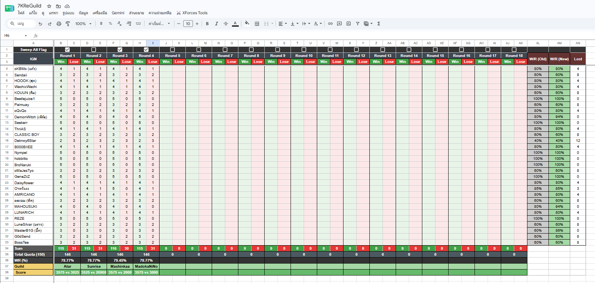
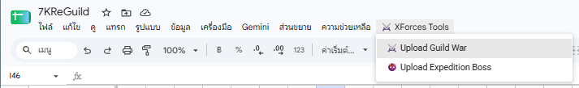
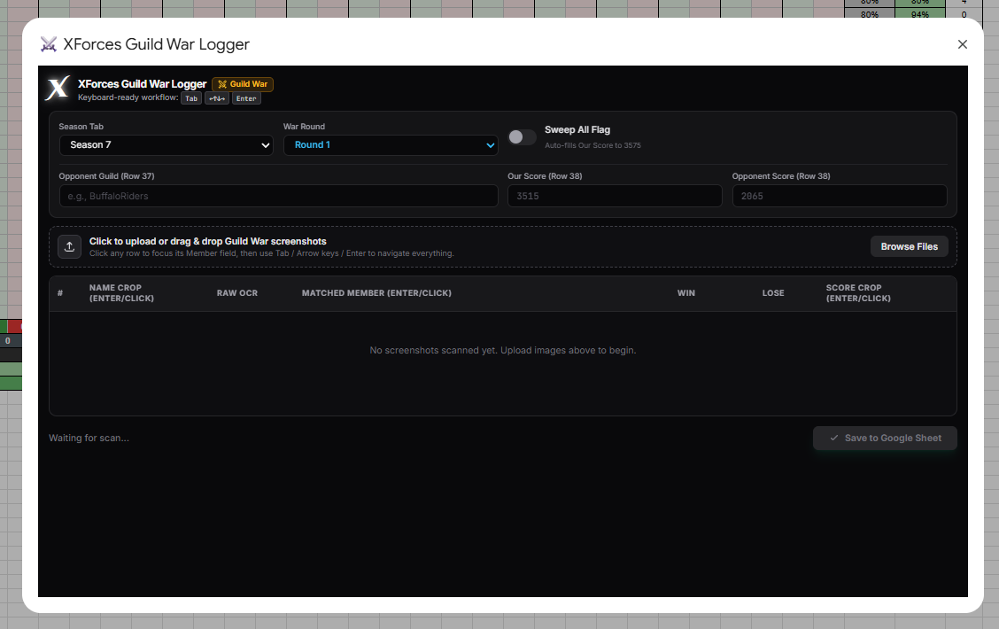
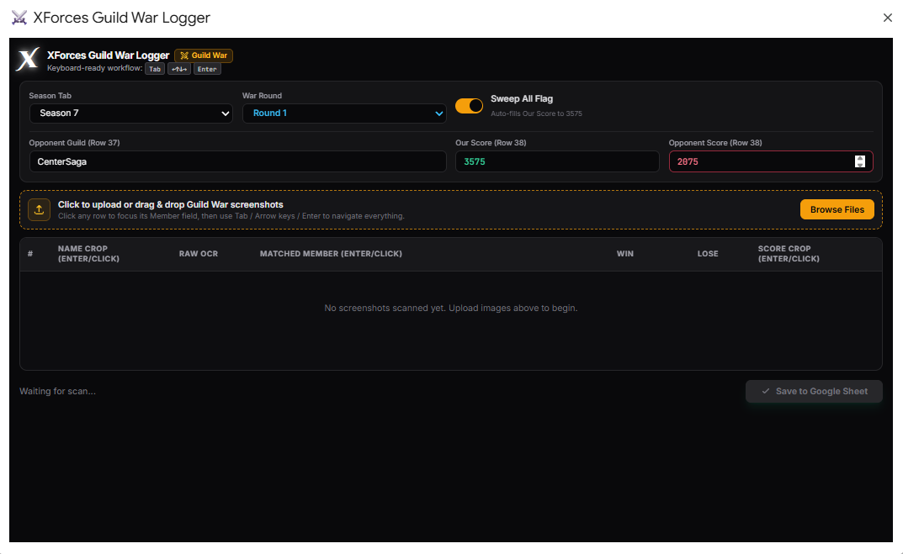
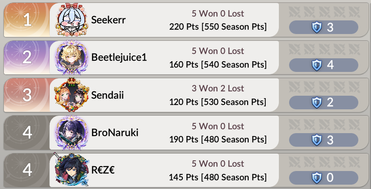
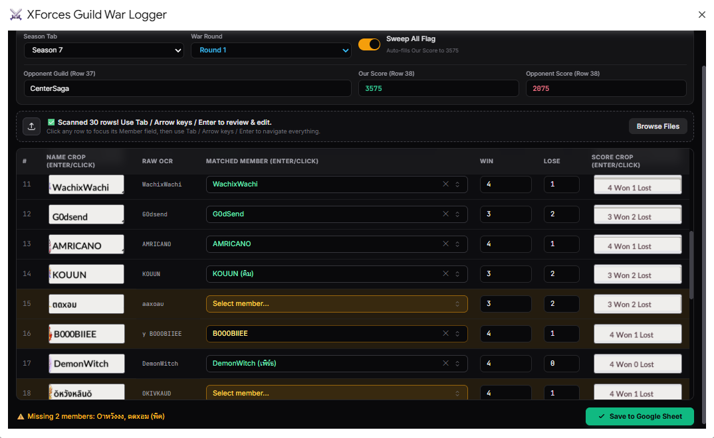
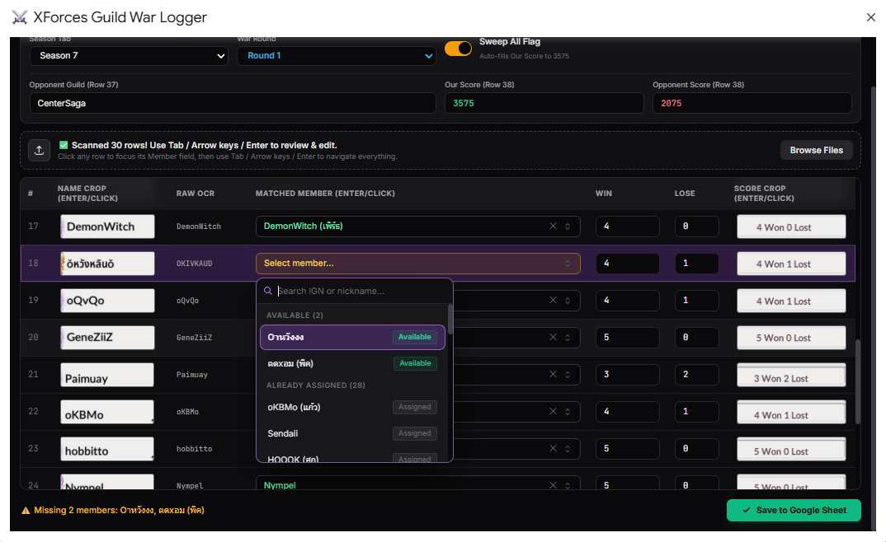
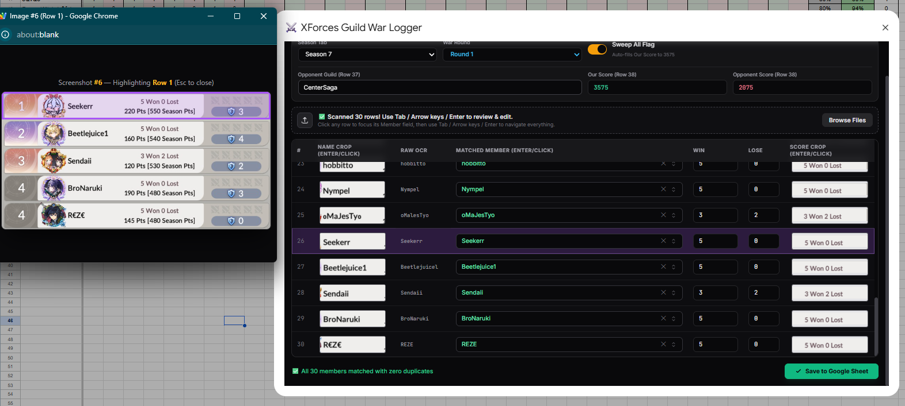
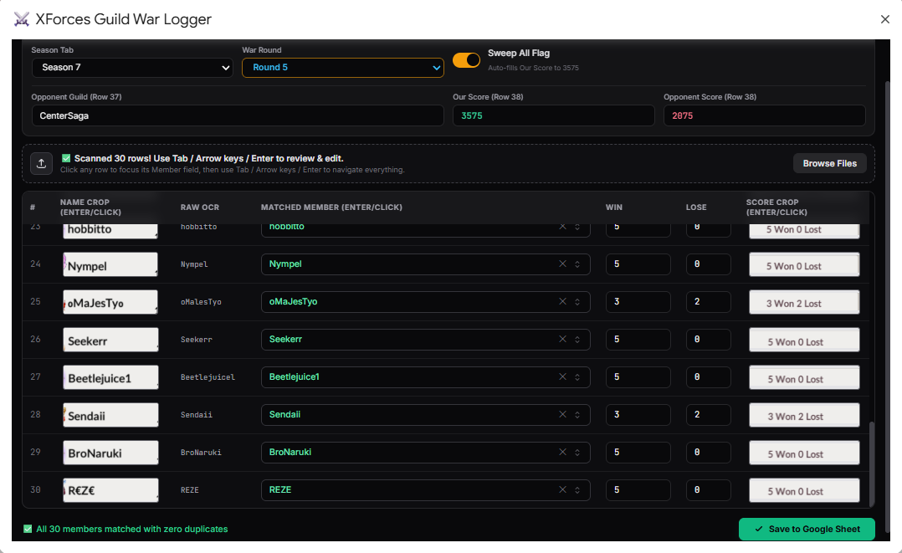
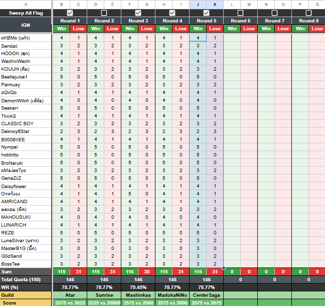

# Seven Knights (Re:BIRTH) — Guild War OCR Auto-Logger

A modular, keyboard-first **Google Apps Script** add-on embedded directly inside Google Sheets for automating score extraction, roster verification, and battle result logging for **Seven Knights (Re:BIRTH)** Guild War activities.

---

## Overview

Logging Guild War battle results manually for 30 members across multiple rounds is repetitive, time-consuming, and error-prone. 

This tool provides a streamlined, client-side OCR solution that runs directly within a Google Sheets modal dialog. Guild leaders and officers can paste or drop battle record screenshots, review real-time fuzzy-matched roster assignments, verify OCR cropped snippets, and synchronize all scores directly into Google Sheets in a single click.

### Key Highlights

- **100% Client-Side OCR (`Tesseract.js v5`)**: Processes battle screenshots entirely in the browser. Zero image uploads to external servers, zero API costs, and total data privacy.
- **Intelligent Fuzzy Roster Matching (`Fuse.js v7`)**: Automatically matches OCR-extracted in-game names (IGN) against the official 30-member roster from the spreadsheet using greedy 1-to-1 unique assignment.
- **Interactive Verification & Crop Preview**: Displays the exact cropped image snippet alongside each extracted record. Click any image thumbnail to zoom in and visually verify OCR readings.
- **Fast Keyboard Navigation**: Complete keyboard workflow using `Tab`, `Arrow keys`, and `Enter` for rapid manual adjustments.
- **Direct Sheet Synchronization**: Maps wins, losses, sweep flags, opponent guild names, and match scores directly to their designated season tabs and round columns.
- **Missing & Duplicate Member Alerts**: Real-time roster tracking alerts officers if any member is missing from the submitted screenshots or assigned more than once.

---

## Workflow & User Guide

### 1. View Guild War Spreadsheet
Open the Google Sheets document containing your Guild War tracking tabs. Each season tab contains member names in rows 4–33 and round pairs across columns B to AK.



---

### 2. Launch the Logger Modal
Navigate to the custom spreadsheet menu:  
`⚔️ XForces Tools` ➔ `⚔️ Upload Guild War`



---

### 3. Guild War Logger Interface
The modal dialog loads automatically, fetching active season tabs and the current 30-member roster from the spreadsheet.



---

### 4. Configure War Details & Upload Screenshots
Select the target **Season Tab**, **War Round** (1–18), set the **Sweep All** flag (auto-sets score to 3575 if applicable), and enter the **Opponent Guild** name and scores. Then drag & drop or paste (`Ctrl+V`) your battle history screenshots (up to 6 images, 5 members per image).



---

### 5. In-Game Screenshot Format
Capture the Guild War battle log screen from Seven Knights (Re:BIRTH). The OCR engine parses player names, win counts, and loss counts from each row.



---

### 6. Review OCR Results & Mismatches
Extracted records are listed in an editable table. If an IGN has low confidence or contains special characters, the status badge alerts you to review it.



---

### 7. Search & Assign Correct Member
Click the member input or press `Enter` to open a searchable fuzzy-lookup dropdown populated with unassigned roster members.



---

### 8. Click-to-Verify Cropped Snippets
Click any cropped screenshot thumbnail to inspect the original image section in high resolution and cross-check ambiguous numbers or names.



---

### 9. Verify Roster Completeness & Submit
Ensure all 30 members are accounted for. The status indicator confirms `"✅ All 30 members matched with zero duplicates"`. Click **Save to Google Sheet** to execute the write.



---

### 10. Automatic Spreadsheet Output
Results are populated into the designated columns and summary rows:
- Win & Loss counts updated per member
- Sweep All status recorded in Row 1
- Opponent Guild written to Row 37
- Match Score written to Row 38



---

## File Structure

```text
├── AppScript/
│   ├── Code.gs             # Menu initialization (⚔️ XForces Tools)
│   ├── GuildWar.html       # Client-side OCR modal, fuzzy matching & verification UI
│   └── GuildWarScript.gs   # Backend Sheet read/write operations
├── src/
│   ├── images/guild-war/   # Step-by-step workflow documentation images
│   └── sheets/
│       └── 7KReGuildLog.xlsx # Sample template with pre-built formulas & sheet layout
├── spec.md                 # System technical specifications and data mapping
└── README.md               # Project documentation
```

---

## Google Sheet Mapping Schema

| Target Range | Field Description | Example / Value |
| :--- | :--- | :--- |
| **Row 1, Win Col** | Sweep All Flag | `TRUE` / `FALSE` |
| **Rows 4–33, Col A** | Guild Member IGN Roster | Extracted dynamically for fuzzy matching |
| **Rows 4–33, Win Col** | Member Wins (Round *N*) | Numeric integer (`0`–`5`) |
| **Rows 4–33, Lose Col** | Member Losses (Round *N*) | Numeric integer (`0`–`5`) |
| **Row 37, Win Col** | Opponent Guild Name | Text (e.g., `BuffaloRiders`) |
| **Row 38, Win Col** | Match Final Score | String (e.g., `3515 vs 2065`) |

> **Column Formula**:  
> For Round $N$ ($1 \le N \le 18$):
> - $\text{Win Column} = 2 + (N - 1) \times 2$ (Round 1 = Column B / Col 2)
> - $\text{Lose Column} = 3 + (N - 1) \times 2$ (Round 1 = Column C / Col 3)

---

## Installation & Setup

### 1. Prepare Google Sheet
- **Option A (Recommended — Use Template):**  
  Upload [`src/sheets/7KReGuildLog.xlsx`](src/sheets/7KReGuildLog.xlsx) to Google Drive and open/save it as a **Google Sheet**. It already includes the pre-configured `GvG Template` tab, sample season sheets, and calculation formulas.
- **Option B (Use Existing Sheet):**  
  Ensure your sheet has season tabs named `Season <N>` or `DD-MM-YYYY` with the 30-member roster placed in rows 4–33 of column A (see [Mapping Schema](#google-sheet-mapping-schema)).

### 2. Deploy Apps Script
1. In your Google Sheet, navigate to **Extensions** ➔ **Apps Script**.
2. Add the following project files:
   - Script file `Code.gs`: Paste contents from `AppScript/Code.gs`
   - Script file `GuildWarScript.gs`: Paste contents from `AppScript/GuildWarScript.gs`
   - HTML file `GuildWar.html`: Paste contents from `AppScript/GuildWar.html`
3. Save the project and refresh your Google Sheets browser tab.
4. The **`⚔️ XForces Tools`** menu will appear in the spreadsheet toolbar. Click **`⚔️ Upload Guild War`** to start logging.

---

## Tech Stack

- **Runtime:** Google Apps Script (`HtmlService`, `SpreadsheetApp`)
- **Client-Side OCR:** [Tesseract.js v5](https://github.com/naptha/tesseract.js)
- **Fuzzy Search:** [Fuse.js v7](https://github.com/krisk/Fuse)
- **UI & Styling:** [Tailwind CSS](https://tailwindcss.com/)
- **Typography:** Google Fonts (`Cinzel Decorative`, `Inter`, `JetBrains Mono`)
